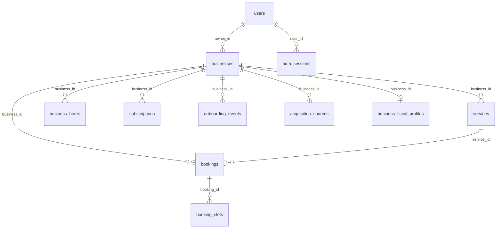

# Base de datos y concurrencia

| Tabla | Propósito y restricciones principales |
|---|---|
| `users` | Propietarios y administradores; correo único, hash de contraseña, estado y rol. |
| `auth_sessions` | Sesiones revocables; digest único, vencimiento e índice por usuario. |
| `businesses` | Tenant; `slug` único, propietario FK, zona horaria y estado de publicación. |
| `services` | Catálogo por negocio; `DECIMAL(10,2)`, duración positiva y desactivación lógica. |
| `business_hours` | Intervalos por día; permite varios por día sin duplicar el mismo inicio. |
| `bookings` | Reserva histórica, servicio del mismo negocio, fechas UTC y estado. |
| `booking_slots` | Slots de 5 minutos con índice único `(business_id, slot_start)`. |
| `subscriptions` | Historial de trial/estado; no representa cobros confirmados. |
| `onboarding_events` | Eventos con origen servidor, reporte de cliente o simulado. |
| `acquisition_sources` | Atribución por negocio; no implica conversión a pago. |
| `business_fiscal_profiles` | Relación 1:0..1 privada, sin exposición pública. |

## Prevención de doble reserva

La reserva pública se crea en una transacción InnoDB. El servicio bloquea la fila del negocio, deriva `appointment_end` de la duración del servicio, valida horario en la zona del negocio y genera un registro por cada slot de 5 minutos. El índice único de `booking_slots` impide que otra transacción reserve el mismo recurso y tramo; ante conflicto se revierte toda la operación y la API devuelve `409 BOOKING_CONFLICT`.

El MVP usa un único recurso por negocio. Si se agregan barberos individuales, `booking_slots` deberá incorporar `professional_id` a su índice único y las reservas deberán seleccionar ese recurso.
