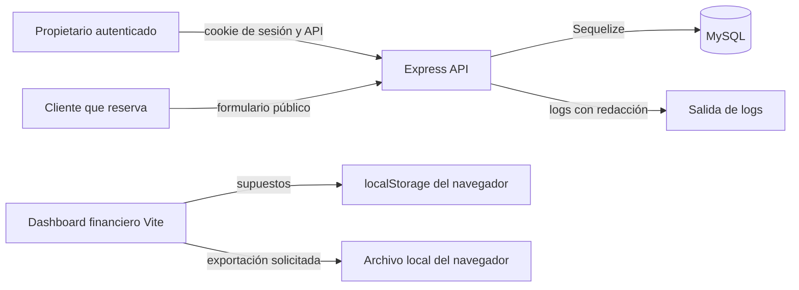

# ADR 003: Ubicación y almacenamiento de datos

- Estado: Aceptado
- Fecha: 2026-11-13
- Decide: Equipo responsable de AGENDO, rol de mantenimiento del producto; nombre individual pendiente de confirmar
- Responsables: Equipo responsable de AGENDO; asignación individual pendiente de confirmar

## Contexto

El backend de AGENDO usa Express, Sequelize y MySQL. Sus migraciones crean tablas para cuentas, sesiones, negocios, servicios, horarios, reservas, eventos de onboarding, atribución, suscripciones y perfiles fiscales. El dashboard financiero de la raíz es una aplicación Vite independiente que conserva sus supuestos en `localStorage` y genera exportaciones en el navegador. El frontend de onboarding se sirve desde Express y consume la API en el mismo origen con cookies de sesión.

## Requisitos de almacenamiento

El sistema requiere persistir cuentas, configuración de negocios, catálogo, horarios, reservas y eventos necesarios para la operación. Debe aislar datos por negocio, prevenir reservas solapadas, conservar sesiones revocables y no persistir contraseñas en texto plano. El dashboard necesita recordar supuestos del navegador sin convertirlos en datos de plataforma. No existe un requisito verificado de almacenar prompts, respuestas de IA, pagos o facturas.

## Opciones consideradas

- MySQL mediante Sequelize para datos operativos y `localStorage` para supuestos del dashboard: opción adoptada y representada en el código.
- Almacenamiento exclusivo en el navegador para reservas y cuentas: descartado porque no permitiría autenticación, aislamiento por negocio ni disponibilidad pública persistente.
- Enviar datos a un proveedor de IA o almacenar resultados de LLM: descartado porque no existe integración de IA en el repositorio.
- Añadir un proveedor de pagos o facturación: descartado en el estado actual; el backend documenta que una suscripción `trialing` no confirma cobros.

## Alternativas descartadas

- Guardar reservas solo en `localStorage`: se descarta porque se perderían al borrar datos del navegador y no permitiría controlar disponibilidad ni autorización desde el servidor.
- Almacenar toda la información de negocio en un proveedor externo no identificado: se descarta porque no hay evidencia de proveedor, región, contrato, controles de acceso o necesidad implementada.

## Decisión

Los datos operativos se almacenan en la base MySQL configurada por `DB_HOST`, `DB_PORT`, `DB_NAME`, `DB_USER` y `DB_PASSWORD`. Los supuestos del simulador financiero y la preferencia de tema se mantienen localmente en el navegador; las exportaciones CSV, JSON, XLSX y PDF se descargan por iniciativa de la persona usuaria. Las sesiones usan una cookie `HttpOnly` en el navegador y solo el HMAC del token se persiste en MySQL. No se envía información a un proveedor de IA. La región, proveedor de hosting, cifrado en reposo, backups y retención de MySQL son **Pendiente de confirmar** porque no están configurados en el repositorio.

## Arquitectura de almacenamiento

## Ubicación de los datos

- **MySQL:** `users`, `auth_sessions`, `businesses`, `services`, `business_hours`, `bookings`, `booking_slots`, `subscriptions`, `onboarding_events`, `acquisition_sources` y `business_fiscal_profiles`.
- **Navegador:** cookie de sesión, supuestos del dashboard financiero y preferencia visual. La persistencia del dashboard se limita al dispositivo o perfil de navegador que la crea.
- **Archivos locales descargados:** reportes y exportaciones que la persona usuaria solicita desde el dashboard; AGENDO no controla su almacenamiento posterior.
- **Logs:** Pino registra eventos del servidor y redacciona cabeceras de autorización, cookies, contraseñas, hashes y tokens según `backend/src/config/logger.js`; su destino y retención de producción no están definidos en el código.
- **Proveedor de IA y servicios de pago:** no aplican al estado actual porque no se identificaron integraciones implementadas.

## Accesos y permisos

Las rutas privadas requieren una sesión válida. El servidor verifica la propiedad del negocio en las operaciones de tenant y reserva el rol `platform_admin` para analítica de plataforma. Las rutas de reserva públicas exponen únicamente el negocio activo, servicios y disponibilidad necesarios para crear una solicitud; no exponen sesiones, perfiles fiscales ni paneles privados. Los permisos de MySQL, consola de hosting y backups no están versionados y deben confirmarse en el entorno de despliegue.

## Seguridad

Las contraseñas se guardan con bcrypt. El token de sesión es aleatorio, llega en cookie `HttpOnly`, usa `sameSite: lax` y se marca `secure` en producción; MySQL guarda un HMAC del token, expiración y revocación. Express aplica Helmet, límite de cuerpo JSON de 1 MB, CORS con origen configurable, validación Zod y rate limit para registro e inicio de sesión. Las reservas usan una transacción y un índice único de slots. Debe confirmarse TLS, cifrado en reposo, administración de secretos, gestión de accesos de MySQL y copias de seguridad de producción.

## Respaldos y recuperación

No hay scripts, infraestructura ni política de respaldo de MySQL en el repositorio. Las migraciones reproducen el esquema, pero no restauran datos operativos. Antes de producción se debe definir frecuencia de backups, cifrado, retención, responsables, pruebas de restauración, objetivos de recuperación y procedimiento ante pérdida o corrupción de datos.

## Retención y eliminación

Las sesiones tienen una caducidad configurable mediante `SESSION_TTL_HOURS`, con valor por defecto de 24 horas y revocación al cerrar sesión. No se encontró una política de purga para cuentas, negocios, reservas, perfiles fiscales, eventos, logs ni archivos exportados. No se encontraron endpoints de supresión de cuenta ni procesos de atención de derechos de acceso o eliminación. Estos plazos y procesos permanecen pendientes de definir antes de producción.

## Datos sensibles y minimización

Las notas de reserva son opcionales y pueden ayudar al negocio a atender una solicitud, pero no deben usarse para recopilar datos de salud, religión, orientación sexual u otra información sensible. Su contenido es libre y por ello se clasifica como potencialmente sensible en el inventario: el formulario debe pedir solo la información necesaria para coordinar la cita y el equipo debe definir filtrado, retención y eliminación antes de producción.

## Consecuencias

La separación entre MySQL operativo y `localStorage` del dashboard reduce la transmisión de supuestos financieros al servidor y permite reservas persistentes con controles de concurrencia. Como contrapartida, una persona puede perder los supuestos locales al borrar datos del navegador y las garantías de disponibilidad, respaldo, residencia y recuperación dependen del entorno de MySQL aún no documentado.

## Riesgos y mitigaciones

Los riesgos principales son acceso indebido a datos personales o fiscales, pérdida de datos por ausencia de backup documentado, exposición de exportaciones locales y contenido sensible en notas de reserva. El código mitiga parte del riesgo con sesiones, validación, autorización, redacción de logs y transacciones. Faltan controles de infraestructura, retención y clasificación de contenidos libres.

## Alternativas futuras

Antes de adoptar un servicio de base de datos administrada, almacenamiento de archivos, analítica externa, notificaciones, pagos o IA, se debe crear un ADR que especifique proveedor, región, categorías de datos, contratos, permisos, cifrado, retención, eliminación, respaldo y transferencia internacional. No se debe inferir esa configuración desde el código actual.

## Cómo se verifica

`backend/src/config/database.js` configura Sequelize con MySQL y variables de entorno. Las migraciones en `backend/src/migrations/` definen las tablas y restricciones. `backend/src/config/logger.js`, `backend/src/services/auth-service.js` y `backend/src/app.js` contienen los controles de logs, sesión y HTTP. `src/utils/storage.ts` y `src/utils/exports.ts` muestran almacenamiento y exportaciones locales del dashboard.

## Evidencia y pendientes

La ubicación física de MySQL, el proveedor de hosting, TLS, cifrado en reposo, respaldos, recuperación, permisos administrativos, retención y proceso de supresión no son verificables en este repositorio. Deben definirse por el equipo responsable antes de tratar datos reales en producción.
