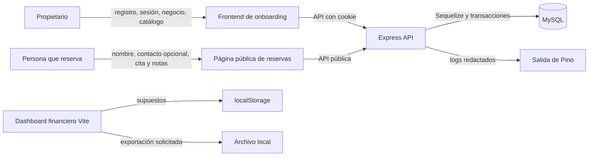

# Inventario de datos

## Información general

- **Proyecto:** AGENDO.
- **Descripción:** plataforma SaaS para barberías y salones. Incluye un frontend de onboarding y reservas, una API Express con MySQL y un dashboard financiero Vite que simula escenarios de crecimiento.
- **Objetivo:** identificar los datos que el sistema recibe, procesa, almacena, transmite o exporta, diferenciando lo verificado en código de lo pendiente de configurar en producción.
- **Última actualización:** 2026-11-13.
- **Responsable:** equipo responsable de AGENDO; nombre y rol operativo individual pendientes de confirmar.

## Clasificación de datos

Se usa la clasificación de la Ley 8968 cuando el dato puede identificar a una persona. La categoría de datos ingresados en campos libres depende de su contenido; la aplicación no exige datos de salud ni otros datos sensibles, pero una persona podría escribirlos en notas de reserva. Los valores de demostración o simulación se distinguen en el código mediante indicadores como `is_demo`, `is_simulated` y `event_origin`.

| Dato | ¿Personal? | Categoría (Ley 8968, art. 9) | De dónde viene | Dónde se guarda | ¿Sale a un tercero? ¿A quién? | Cuánto se conserva | Quién puede verlo |
| --- | --- | --- | --- | --- | --- | --- | --- |
| Identidad y credenciales de propietario: nombre, apellido, correo, hash de contraseña, rol y estado | Sí | Acceso restringido | Registro e inicio de sesión del propietario en el frontend | Tabla `users` en MySQL; la contraseña se guarda como hash bcrypt | No se identificó un proveedor externo en el código; el navegador envía el registro a la API de AGENDO | No hay política de retención o supresión definida | La propia persona mediante sesión; administradores de plataforma según controles del servidor y administradores de MySQL pendientes de confirmar |
| Datos de sesión: token en cookie, digest HMAC, vencimiento, revocación, agente de usuario e IP hasheada | Sí | Acceso restringido | Inicio de sesión, encabezados HTTP y dirección IP de la solicitud | Cookie `HttpOnly` del navegador y tabla `auth_sessions` en MySQL; solo el digest se persiste | No se identificó envío a terceros; circula entre navegador y API | La sesión usa `SESSION_TTL_HOURS`, con valor por defecto de 24 horas; la purga posterior no está definida | Navegador titular de la cookie y servidor de AGENDO; administradores de MySQL pendientes de confirmar |
| Perfil y datos operativos del negocio: nombre, slug, teléfono, dirección, descripción, logo, zona horaria y estado | Sí, puede identificar al propietario o negocio individual | Acceso restringido | Onboarding autenticado del propietario | Tabla `businesses` en MySQL | Se muestran nombre, descripción, horario y servicios en la página pública cuando el negocio está activo; no hay otro tercero configurado | No hay política de retención definida | Propietario autenticado; visitantes pueden consultar campos públicos de negocios activos; administradores de plataforma en los límites del código |
| Catálogo de servicios, precios, duración y horarios | No, salvo que el contenido libre identifique a una persona | No aplica | Propietario autenticado durante configuración del negocio | Tablas `services` y `business_hours` en MySQL | Se expone a visitantes en la página pública de reservas si el negocio está activo | No hay política de retención definida | Propietario y rutas públicas necesarias para reservar; acceso administrativo pendiente de confirmar |
| Datos de reserva: nombre, correo opcional, teléfono opcional, servicio, fecha, estado y notas | Sí | Acceso restringido; las notas son potencialmente Sensible según su contenido | Formulario público de reservas | Tablas `bookings` y `booking_slots` en MySQL | No se identificó envío a terceros; el cliente los envía a la API de AGENDO | No hay política de retención definida | Propietario autorizado del negocio y administradores de MySQL; la persona que reserva recibe solo la respuesta de creación |
| Datos fiscales del negocio: razón social, identificador legal, régimen y dirección fiscal | Sí, cuando se relacione con una persona física | Acceso restringido | Modelo previsto para perfil fiscal; no hay endpoint de captura identificado | Tabla `business_fiscal_profiles` en MySQL | No se identificó envío a terceros ni endpoint público | No hay política de retención definida | No hay rutas públicas; acceso de aplicación específico pendiente de implementar y acceso de MySQL pendiente de confirmar |
| Eventos de onboarding, metadatos y atribución de adquisición | Sí, potencialmente si `metadata` contiene identificadores | Acceso restringido | Acciones autenticadas del onboarding y datos de creación de negocio | Tablas `onboarding_events` y `acquisition_sources` en MySQL | No se identificó envío a terceros | No hay política de retención definida | Propietario por los flujos de su negocio y administradores de plataforma para analítica; alcance exacto de metadatos pendiente de controlar |
| Estado de suscripción: plan, trial, períodos y estado | Sí, vinculado al negocio y propietario | Acceso restringido | Creación de negocio y servicios internos | Tabla `subscriptions` en MySQL | No hay proveedor de pago ni facturación configurados | No hay política de retención definida | Propietario autenticado en `GET /subscriptions/me`; administradores de MySQL pendientes de confirmar |
| Supuestos, escenarios y resultados del dashboard financiero | No en el caso base; pueden ser confidenciales si la persona introduce cifras reales | No aplica para el caso base | Controles del dashboard y datos estáticos del caso | `localStorage` del navegador; exportaciones solicitadas se descargan localmente | No se identificó envío al backend ni a proveedores externos | Hasta que el navegador borre los datos o la persona use la función de reseteo; las exportaciones dependen del dispositivo | La persona que usa el mismo perfil de navegador y quien reciba una exportación compartida |
| Logs técnicos y errores de API | Sí, potencialmente por identificadores de solicitud o contexto operativo | Acceso restringido | Solicitudes HTTP y operación del servidor | Salida configurada por Pino; destino persistente no definido en el repositorio | No se identificó un proveedor de observabilidad externo | Retención pendiente de definir | Operadores del entorno de servidor; acceso concreto pendiente de confirmar |

## Flujo de datos

No se encontró una llamada a proveedor de IA, pagos, correo, mensajería, analítica externa ni almacenamiento de archivos. La aplicación servida por Express usa el mismo origen para frontend y API; la configuración efectiva de producción puede introducir servicios no visibles en el repositorio y debe inventariarse antes de usarlos.

## Medidas de protección

### Implementadas

- Validación de cuerpos con Zod y límite de JSON de 1 MB.
- Contraseñas con bcrypt; token aleatorio en cookie `HttpOnly` y solo HMAC del token en MySQL.
- Sesiones con expiración configurable, revocación y `secure` en producción.
- Autorización de rutas privadas y comprobación de propiedad del negocio en servidor; analítica global restringida al rol `platform_admin`.
- Helmet, CORS con origen configurable, rate limit en registro e inicio de sesión y redacción de secretos en Pino.
- Transacciones e índice único de slots para prevenir reservas simultáneas.
- Datos del dashboard financiero almacenados localmente, sin evidencia de envío al backend o a IA.

### Recomendadas o pendientes

- Definir retención, supresión, exportación y respuesta a solicitudes de datos personales.
- Limitar y documentar el esquema permitido para `metadata` y las notas de reserva; evitar datos sensibles innecesarios.
- Configurar TLS, cifrado en reposo, backups, restauración, mínimos privilegios de MySQL y gestión de secretos en el entorno real.
- Confirmar proveedor, región, acceso a logs, retención de logs y visibilidad de exportaciones.
- Evaluar protección CSRF apropiada si el despliegue usa cookies con orígenes o flujos distintos.

## Lo que NO recolectamos

- Datos de tarjetas, cuentas bancarias, pagos, cobros o facturación: el repositorio indica que no hay pagos ni facturación implementados.
- Prompts, respuestas, archivos o perfiles enviados a un proveedor de IA: no existe una integración de IA de producto en el código.
- Datos biométricos, salud, religión, orientación sexual o identificadores gubernamentales de clientes: no son campos requeridos; las notas deben evitar incluirlos.
- Geolocalización precisa y archivos adjuntos de clientes: no hay campos ni endpoints que los reciban.

## Hallazgos pendientes

- Confirmar proveedor, región, cifrado, accesos administrativos, backups y recuperación de MySQL en producción.
- Definir quién responde por privacidad, seguridad y atención de derechos de las personas titulares.
- Definir periodos de retención y supresión para cada tabla, logs, sesiones revocadas y exportaciones.
- Revisar el alcance y filtrado de `metadata` de onboarding y notas de reserva antes de producción.
